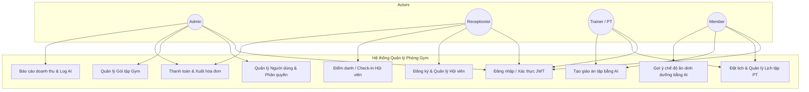
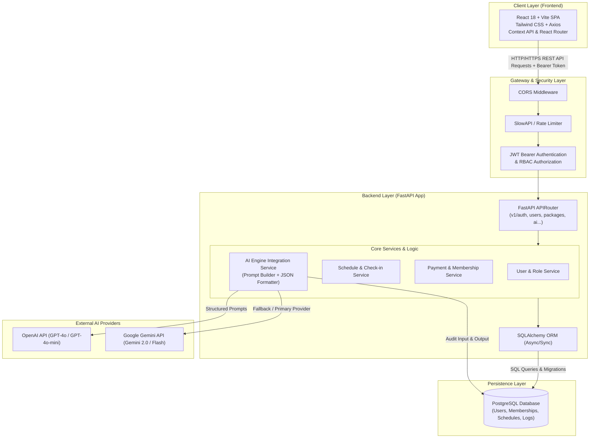

# KIẾN TRÚC HỆ THỐNG QUẢN LÝ TRUNG TÂM THỂ HÌNH TÍCH HỢP AI
**Gym & Fitness Center Management System with AI Integration**

---

## 1. Giới thiệu tổng quan
Hệ thống là giải pháp toàn diện cho phòng tập thể hình (Gym & Fitness Center), tích hợp trí tuệ nhân tạo (Generative AI) để tự động hóa nghiệp vụ quản lý hội viên, huấn luyện viên (PT), điểm danh, thanh toán gói tập và cố vấn cá nhân hóa lịch tập, chế độ dinh dưỡng theo mục tiêu thể hình.

---

## 2. Sơ đồ Use Case & Phân quyền Actors

Hệ thống phục vụ 4 nhóm tác nhân (Actors) chính với các quyền hạn cụ thể:

### 2.1. Danh sách Actors
1. **Admin (Quản trị viên)**:
   - Toàn quyền quản trị hệ thống, quản lý người dùng, phân quyền vai trò.
   - Quản lý danh mục gói tập (Packages), cấu hình giá và thời lượng.
   - Theo dõi doanh thu, báo cáo tài chính thanh toán (Payments).
   - Giám sát nhật ký hoạt động AI (AI Logs) và kiểm tra hạn ngạch API.
2. **Lễ tân (Receptionist)**:
   - Đăng ký và tiếp nhận hội viên mới tại quầy.
   - Tạo hồ sơ gói tập (Memberships) và ghi nhận thanh toán tại quầy.
   - Quản lý điểm danh (Check-in / Attendance) hàng ngày qua mã hội viên/QR.
   - Tra cứu trạng thái hiệu lực gói tập của hội viên.
3. **Huấn luyện viên (PT - Personal Trainer)**:
   - Xem và quản lý hồ sơ chuyên môn cá nhân (Trainer Profile).
   - Xem danh sách lịch hẹn tập luyện (Workout Schedules) được phân công.
   - Cập nhật trạng thái buổi tập, ghi chú đánh giá thể trạng hội viên sau buổi tập.
   - Sử dụng AI để gợi ý giáo án bài tập (Workout Plan) tối ưu cho học viên.
4. **Hội viên (Member)**:
   - Quản lý thông tin cá nhân và lịch sử tập luyện.
   - Xem thông tin gói tập hiện tại, ngày hết hạn và lịch sử thanh toán.
   - Đặt lịch hẹn tập với Huấn luyện viên cá nhân (PT).
   - Sử dụng tính năng **Trợ lý AI thể hình**: Nhập chỉ số cơ thể (chiều cao, cân nặng, BMI, mục tiêu tăng cơ/giảm mỡ) để nhận kế hoạch tập luyện và thực đơn dinh dưỡng cá nhân hóa.

### 2.2. Use Case Diagram (Mermaid)



---

## 3. Kiến trúc Hệ thống & Luồng Dữ liệu (System Architecture & Data Flow)

Hệ thống được thiết kế theo mô hình **Client - Server Decoupled** (Microservices-ready Monolith):



### 3.1. Luồng dữ liệu chi tiết cho tính năng Cố vấn Thể hình AI (AI Fitness Advisor):
1. **User Action**: Hội viên/PT gửi yêu cầu từ giao diện React Form (ví dụ: tuổi: 25, cân nặng: 75kg, chiều cao: 172cm, mục tiêu: "Giảm 5kg mỡ trong 2 tháng", chấn thương: "Đau khớp gối nhẹ").
2. **Frontend Validation**: Pydantic/Zod schema kiểm tra dữ liệu đầu vào và gửi kèm Access Token JWT qua `Axios` tới endpoint `POST /api/v1/ai/generate-workout`.
3. **Backend Middleware**: Kiểm tra quyền truy cập (RBAC), kiểm tra giới hạn tần suất yêu cầu (Rate Limit: tối đa 5 request/phút đối với AI endpoint).
4. **AI Service Processing**:
   - Nạp System Prompt và chèn thông tin người dùng vào User Prompt mẫu.
   - Chỉ định Response Schema định dạng chuẩn JSON (structured output).
   - Gọi OpenAI hoặc Gemini API.
5. **Persist & Audit Log**:
   - Backend lưu lại `prompt_type`, `input_data`, `ai_response` vào bảng `AILogs`.
6. **Response Delivery**:
   - Trả về đối tượng JSON hoàn chỉnh cho Frontend để render thành lịch tập trực quan dạng timeline/thẻ bài tập.

---

## 4. Yêu cầu Phi chức năng (Non-Functional Requirements)

### 4.1. Bảo mật & Xác thực (Security & Authentication)
- **JWT (JSON Web Token)**:
  - Sử dụng thuật toán mã hóa `HS256` (hoặc `RS256` khi mở rộng).
  - Phân tách **Access Token** (thời hạn ngắn: 60 phút) và **Refresh Token** (thời hạn dài: 7 ngày) được lưu trữ an toàn.
  - Mật khẩu người dùng được băm bằng thuật toán `bcrypt` kết hợp salt ngẫu nhiên, không lưu mật khẩu thô.
- **RBAC (Role-Based Access Control)**:
  - Cung cấp Dependency Injection trong FastAPI (`require_roles([UserRole.ADMIN, UserRole.RECEPTIONIST])`) để bảo vệ các endpoints theo nguyên tắc đặc quyền tối thiểu (Least Privilege).

### 4.2. Giới hạn tần suất gọi API (Rate Limiting)
- Áp dụng Rate Limiting thông qua `slowapi` (dựa trên thuật toán Token Bucket / Fixed Window):
  - Auth endpoints (Login): 5 lần/phút nhằm chống Brute Force.
  - AI endpoints (Generate Plan): 5 lần/phút/user nhằm kiểm soát chi phí token và ngăn chặn lạm dụng.
  - Standard REST endpoints: 60 - 120 lần/phút.

### 4.3. Xử lý lỗi tập trung (Centralized Error Handling)
- Chuẩn hóa cấu trúc phản hồi lỗi của hệ thống:
  ```json
  {
    "success": false,
    "error_code": "RESOURCE_NOT_FOUND",
    "message": "Không tìm thấy thông tin gói tập được yêu cầu",
    "details": null
  }
  ```
- Bắt tất cả ngoại lệ chưa được xử lý thông qua `Global Exception Handler` của FastAPI để che giấu stack trace nhạy cảm với người dùng cuối trong môi trường Production.

### 4.4. Hiệu năng & Khả năng mở rộng (Performance & Scalability)
- Sử dụng kết nối cơ sở dữ liệu dạng Connection Pooling qua SQLAlchemy (`pool_size=10`, `max_overflow=20`).
- Tách biệt các tác vụ tốn thời gian (gọi AI API) theo cơ chế `async/await` non-blocking I/O.
- Dễ dàng container hóa qua Docker & Docker Compose để triển khai độc lập.
